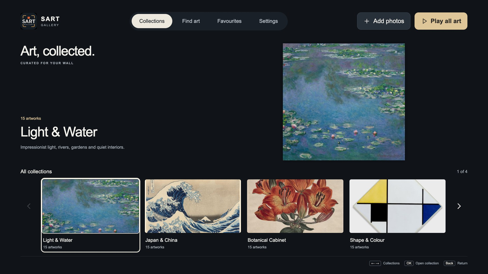
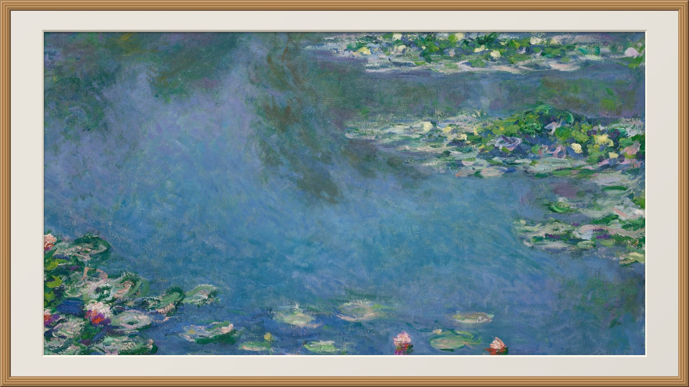
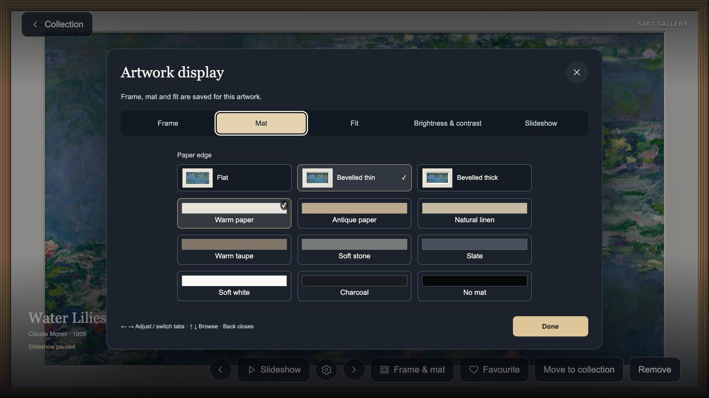

# SART Gallery

**Your art. A quieter screen.**

Bring art and your own photographs to your Samsung Tizen TV. Choose from 60 included artworks, build your own collections, and give each image the right frame, mat and light. Use the TV remote to browse, settle on a favourite, or let a slideshow fill the room.

SART Gallery saves your collection on the TV, with no advertising, analytics or cloud photo account. Send photos directly from a phone or computer over your home network, or discover public-domain art from supported sources.

[](https://github.com/savukadoo/sart-gallery/actions/workflows/ci.yml) · [AGPL-3.0-only](LICENSE) · [Help](SUPPORT.md) · [Contributing](CONTRIBUTING.md)



*Browse your collections with the TV remote. Included artwork is available offline.*

<p>
  
  
</p>

*A quiet artwork display, with frames, paper colours and bevels you can adjust to suit the room. These are real browser-preview screenshots using included artwork and a disposable demo library; native TV features require hardware validation.*

## Features

- Four collections of 15 artworks: Light & Water, Japan & China, Botanical Cabinet, and Shape & Colour.
- Remote/D-pad navigation, favourites, named collections, moving images between collections and bulk upload management.
- Frames, muted mat colours, thin/thick bevels, Fit/Fill, brightness and contrast adjustments.
- Slideshow timer, order, transitions and optional gentle pan and zoom.
- Find art from enabled museum/Artvee sources, five recent searches, batch downloads and custom Wikimedia Commons categories.
- Phone and computer uploads through the TV-hosted HTTPS page and encrypted WebRTC transfers. A separate always-on computer is not required for ordinary direct uploads.
- Optional Samsung Art Mode integration on supported Frame models. Native capability is checked before offering the feature; Samsung's Art Mode manages its own display and power settings.
- No advertising or analytics. Uploaded display copies omit location metadata.

## Compatibility

One web-widget package targets Tizen 6.5 and newer, using an ES2020 syntax baseline. Optional APIs are detected at runtime. Availability of native Art Mode, sockets and other platform services varies by model and firmware; successful installation alone is not feature acceptance.

See [platform compatibility](design/tizen-compatibility.md), [native Art design](design/native-art.md), and the [engineering guide](design/engineering-handover.html). These public documents contain generic procedures and capability limits. Device inventories, deployment history, identifiers and personal network configuration are private local records.

SART is an independent project. It is not affiliated with Samsung, and is not an official Samsung Art Store client. Installing a development build requires Developer Mode and Samsung-issued signing certificates. Ordinary direct photo uploads do not require a running computer or developer connection.

## Local preview

Use Python 3.11+ and Node.js 22+:

```sh
python3 -m venv .venv
.venv/bin/python -m pip install --require-hashes -r requirements.lock
npm ci --ignore-scripts
.venv/bin/python tools/package_app.py
.venv/bin/python companion/server.py
```

Open **http://127.0.0.1:8767/preview/**. The optional desktop service listens on loopback for HTTP. LAN/legacy-library service requires explicit HTTPS configuration and an explicit TV allowlist; no personal TV address is embedded in the public defaults. Direct phone/computer uploads use the TV-hosted connection flow.

## Build and test

```sh
.venv/bin/python tools/package_app.py
npm test
npm run check
.venv/bin/python -m unittest discover -s tests -p 'test_*.py'
.venv/bin/python tools/release.py
```

The builder creates `dist/widget/`, `dist/build.json` and `dist/SART-Gallery-<version>-unsigned.wgt`. A development source ZIP is produced by `tools/release.py`. Acorn is a build-time syntax checker, not a TV dependency. Runtime assets are local; no CDN or framework is needed.

Automated tests cover logic, storage, parsing, source management, image processing and local TLS fixtures. Real remote/IME behaviour, display bounds, native Art handoff and physical-phone uploads require separate hardware acceptance. Temporary loopback listeners may need permission in a restricted test environment.

GitHub Actions checks the public repository boundary, runs the JavaScript and Python suites, builds the widget, validates licences and checks reproducibility. A separate browser job checks Settings geometry and remote navigation at two viewport sizes, with and without native Art capability. CodeQL checks JavaScript and Python. CI does not sign or publish packages, create releases or connect to TVs. See [contribution and maintenance guidance](CONTRIBUTING.md).

## Install on a TV

1. Enable Developer Mode using Samsung's Apps-screen procedure for the target TV. Enter the development computer's LAN address and fully restart the TV.
2. Use the TV's actual address and select an exact model registered by the installation tool. The tool verifies the device identity before allowing access.
3. Obtain a Samsung developer signing profile for that TV. Keep the author identity for future updates and add the target's DUID to the distributor permissions.
4. Sign/install, launch and validate the required features. Preserve photos, preferences and HTTPS identity across updates; never uninstall simply to update.

```sh
.venv/bin/python tools/tv.py status --tv TV_ADDRESS --model REGISTERED_MODEL
.venv/bin/python tools/tv.py certs --tv TV_ADDRESS --model REGISTERED_MODEL
.venv/bin/python tools/tv.py install --tv TV_ADDRESS --model REGISTERED_MODEL
.venv/bin/python tools/tv.py launch --tv TV_ADDRESS --model REGISTERED_MODEL
```

`SART_TV_HOST` can supply the address instead. Local developer defaults may live in `.local/developer-targets.json`; that file is ignored by Git and excluded from release archives. No TV or computer address is assumed for a fresh checkout. Samsung login/verification is completed by the operator; credentials and installation certificates are not public project assets.

References: [Samsung device connection](https://developer.samsung.com/smarttv/develop/getting-started/using-sdk/tv-device.html) and [Samsung certificates](https://developer.samsung.com/smarttv/develop/getting-started/setting-up-sdk/creating-certificates.html).

## Connection security

The TV upload page uses a unique local HTTPS identity. With the manual-trust approach, users obtain the public certificate through the temporary setup page, compare its fingerprint on the TV, and manually install/trust it. The setup listener serves public certificate files only; photos and pairing stay encrypted. Approval is session-bound and temporary listeners close when the connection flow ends.

Keep private authorities, signing keys, profiles, user libraries, diagnostics and screenshots outside public source. See [HTTPS design](design/https.md) and [artwork rights](ARTWORK-RIGHTS.md). A local preview does not establish store certification or worldwide artwork clearance.

## Licence

SART's own code, tests, tools, original documentation and UI assets are licensed under **GNU AGPL version 3 only** (`AGPL-3.0-only`). See [LICENSE](LICENSE). Original third-party licences and copyright notices are preserved in [NOTICE](NOTICE) and [LICENSES/](LICENSES/). Mbed TLS uses its Apache-2.0 option; the QR generator, AeroTizen installation helpers and Acorn retain MIT. Desktop dependencies and the WASI/LLVM runtime retain their own notices.

Artwork, catalogue metadata and user photos have separate rights. The 49 museum images are recorded as CC0/public domain. Artvee's terms and all 11 matching pages confirm personal/commercial reuse permission; the Australian term assessment supports use. This is not unrestricted worldwide clearance: individual US publication histories remain unverified. See [ARTWORK-RIGHTS.md](ARTWORK-RIGHTS.md), [image provenance](app/assets/provenance.json) and [the individual Artvee checks](app/assets/artvee-rights-review.json).

The widget and source archive contain the licence texts and artwork notices. When sharing an executable, provide access to its corresponding source and required build materials under AGPLv3 section 6. Modified versions with network users must also meet section 13. The public source repository is [savukadoo/sart-gallery](https://github.com/savukadoo/sart-gallery).

## TLS source and rebuilding

The checked-in TLS WebAssembly files are built from Mbed TLS 3.6.7 and SART's adapters/configuration under `tools/tls/`.

1. Obtain the [official Mbed TLS 3.6.7 archive](https://github.com/Mbed-TLS/mbedtls/releases/download/mbedtls-3.6.7/mbedtls-3.6.7.tar.bz2), SHA-256 `a7e8bcbec0e6f761b4af24f25677626b35f762f68eef79c08677a363212d11f6`. Extract into `.local/tls-build/mbedtls/mbedtls-3.6.7` and retain the archive at `/private/tmp/sart-mbedtls.tar.bz2` for hash checks.
2. Obtain [WASI SDK 34.0 for ARM macOS](https://github.com/WebAssembly/wasi-sdk/releases/download/wasi-sdk-34/wasi-sdk-34.0-arm64-macos.tar.gz), SHA-256 `9c59398106b417f8f14913380fdf0097a8cc0ff4af9eb3ce0065a859e88d49e9`. Extract into `.local/tls-build/wasi/`. Runtime revisions and notices are in `LICENSES/provenance.json`.
3. Run `.venv/bin/python tools/build_tls.py` and `.venv/bin/python tools/build_native_art_tls.py`, then rebuild the widget.

A distributor is responsible for continued access to corresponding source; an upstream link does not guarantee its future availability. Keep private keys and user/device data outside distributions.
